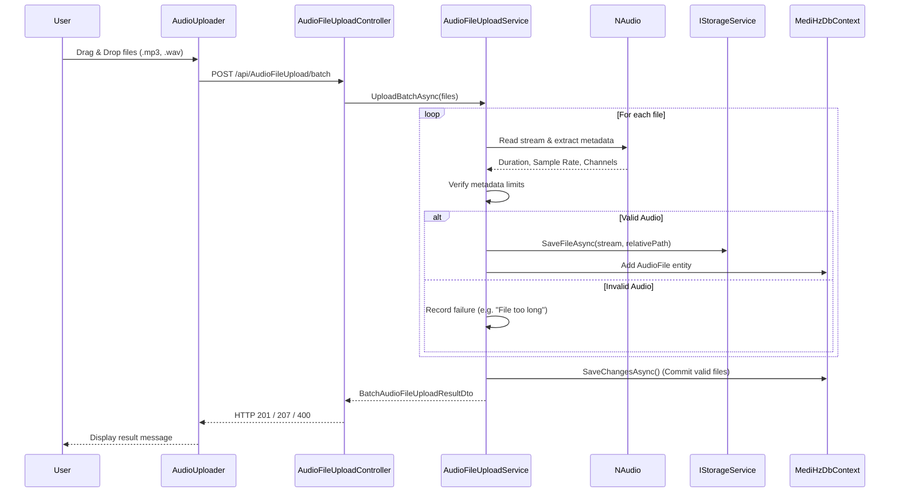

# Audio File Upload Process

This document details the audio file upload process in the MediHz application, covering the frontend user interface, API specifications, system architecture, and file storage conventions.

## Front End UI (How to Upload)

The audio upload functionality is handled by the `AudioUploader` React component.

- **Interaction**: Users can either drag and drop audio files into the designated dropzone area or click the dropzone to open a file selection dialog.
- **Supported Formats**: Only `.mp3` and `.wav` formats are accepted.
- **Feedback**: 
  - While files are uploading, the UI displays: *"Uploading files to server, please wait..."*.
  - If an unsupported file is dragged, the UI indicates: *"Unsupported file format. Please upload MP3 or WAV files."*.
  - Upon completion, the component shows the number of successfully uploaded files and the resulting `Batch ID`, or an error message if the upload fails.

## API URL

**Endpoint:** `POST /api/AudioFileUpload/batch`
- Usually hosted at `http://localhost:5001/api/AudioFileUpload/batch` (or the configured backend port).

## API Package and Response Formatting

### Request Format
- **Content-Type**: `multipart/form-data`
- **Payload**: The request must include one or more files under the form field name `files`.

### Response Format
The API responds with a JSON object representing the `BatchAudioFileUploadResultDto` which contains the overall batch identifier and details for each file processed.

**HTTP Status Codes:**
- `201 Created`: All files were successfully uploaded and processed.
- `207 Multi-Status`: Partial success (some files uploaded successfully, others failed).
- `400 Bad Request`: No files were supplied, or all files failed validation/processing.

**JSON Response Example:**
```json
{
  "batchId": "f47ac10b-58cc-4372-a567-0e02b2c3d479",
  "items": [
    {
      "id": "550e8400-e29b-41d4-a716-446655440000",
      "fileName": "patient_recording_1.mp3",
      "mimeType": "mp3",
      "sizeBytes": 2048576,
      "status": 1,
      "errorMessage": null
    },
    {
      "id": "00000000-0000-0000-0000-000000000000",
      "fileName": "corrupted_audio.wav",
      "mimeType": null,
      "sizeBytes": 500,
      "status": 0,
      "errorMessage": "File is too short"
    }
  ]
}
```
*(Note: `status: 1` represents Success, `status: 0` represents Failure)*

## Architecture Diagram

The upload process involves multiple layers, from the React frontend down to the database and storage services. The backend parses the audio file metadata (duration, sample rate, channels) using the `NAudio` library and validates it before saving.

- **Validation Rules**:
  - Maximum duration: 1800 seconds (30 minutes)
  - Minimum duration: 1 second
  - Minimum sample rate: 5000 Hz



## File Naming Convention

When valid audio files are saved by the storage service, they do not retain their original uploaded filenames on disk. Instead, they are organized by their associated project and named using their unique database `Id` and `Format`.

**Format:** `{ProjectId}/{AudioFileId}.{Format}`

**Example:**
`exampleProjectId/550e8400-e29b-41d4-a716-446655440000.mp3`

*(Note: If a project ID is not explicitly provided, it currently defaults to the fallback directory `"exampleProjectId"`.)*
